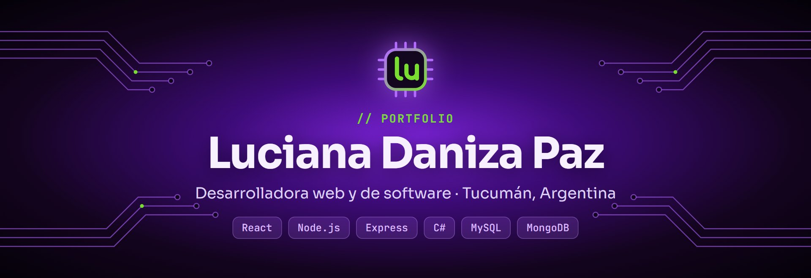
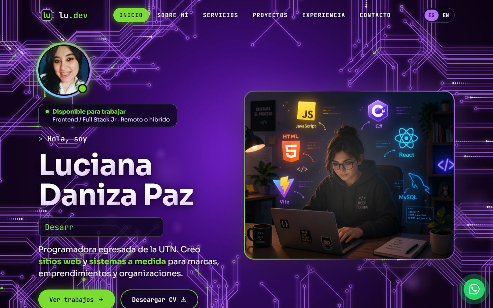
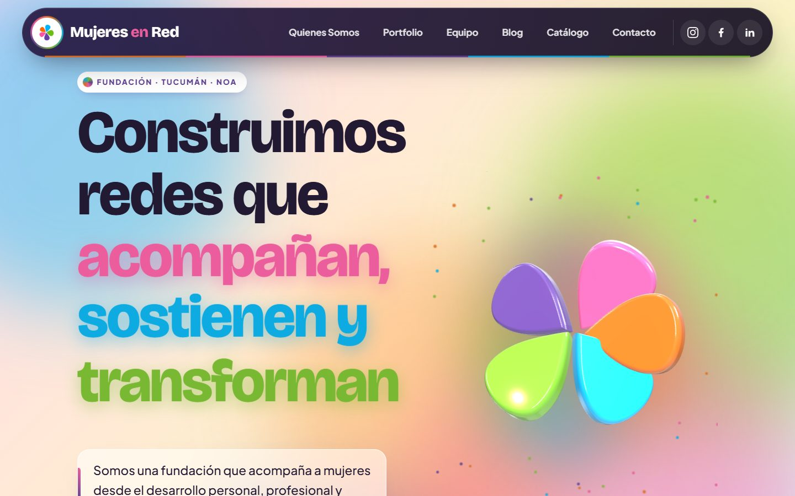
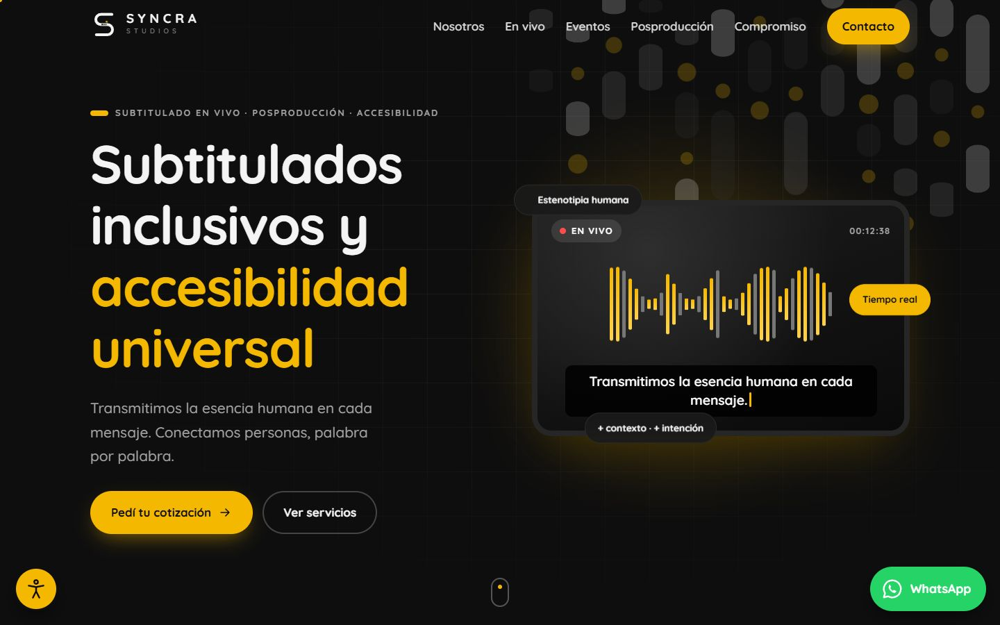
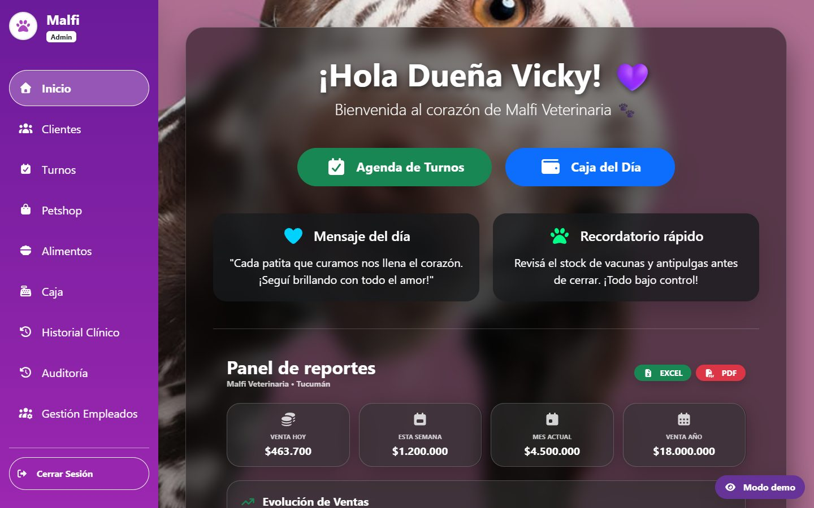
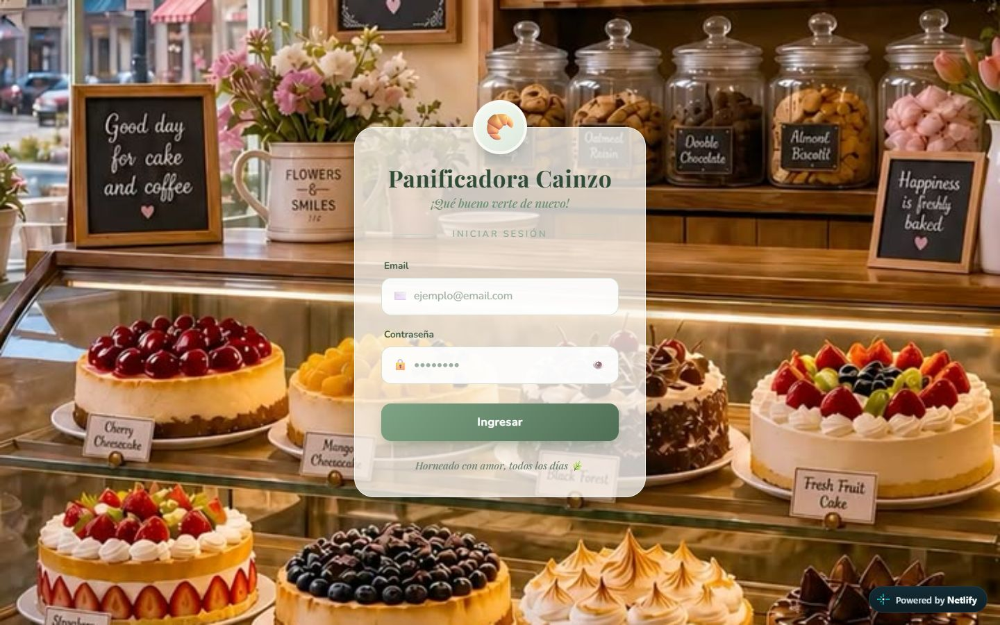
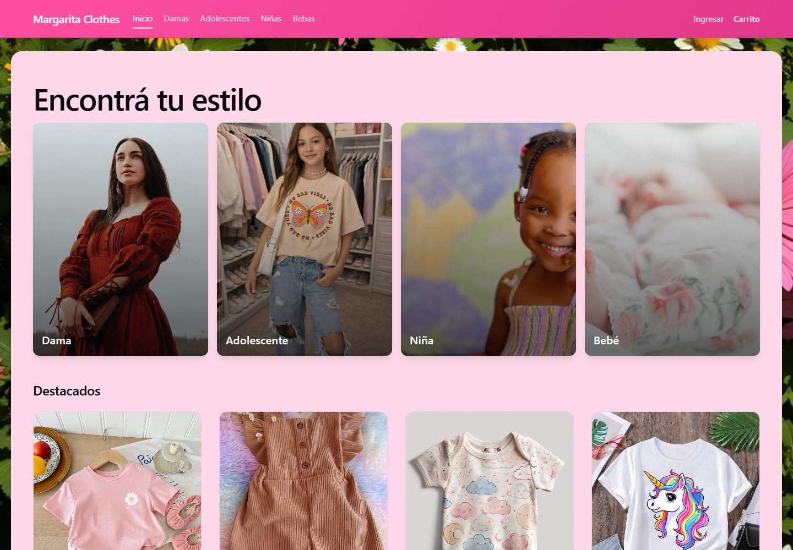
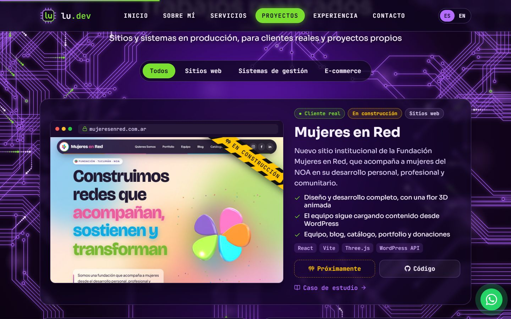
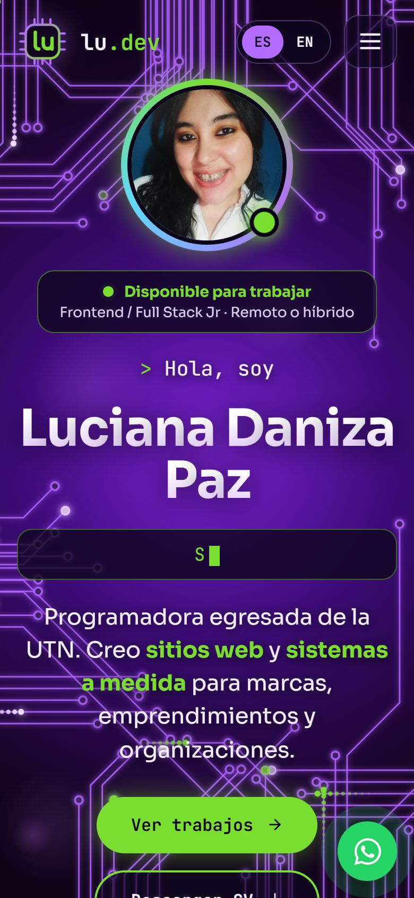

<div align="center">



<br>

<a href="https://lucianadanizapaz.com"></a>
<a href="https://www.linkedin.com/in/daniza-paz-67920a415"></a>
<a href="mailto:lucianadanizapaz@hotmail.com"></a>

<br><br>


</div>

<br>

## 👋 Hola, soy Lu

Programadora egresada de la **Tecnicatura Universitaria en Programación (UTN-FRT)** y desarrolladora web en la **Fundación Mujeres en Red**, donde diseñé y desarrollé los sitios de la fundación y de **Syncra Studios**.

Este repositorio es mi portfolio: un sitio pensado tanto para **empresas** que buscan sumar una desarrolladora Frontend / Full Stack Jr al equipo como para **clientes** que necesitan un sitio web o un sistema a medida.

<br>

<div align="center">
  
</div>

<br>

## ✨ Lo que vas a encontrar

<table>
  <tr>
    <td width="50%" valign="top">
      <h3>🎨 Diseño con movimiento</h3>
      Fondo de circuito dibujado con <b>Canvas</b>, con pulsos de luz que recorren las pistas. Animaciones de entrada, scroll y hover con <b>Framer Motion</b>: tipeo, órbita de tecnologías, tarjetas con inclinación 3D y una línea de tiempo que se dibuja al bajar.
    </td>
    <td width="50%" valign="top">
      <h3>🌎 Bilingüe</h3>
      Español e inglés con cambio instantáneo. Recuerda el idioma elegido, detecta el del navegador y ofrece el CV correspondiente para descargar.
    </td>
  </tr>
  <tr>
    <td valign="top">
      <h3>💼 Proyectos reales</h3>
      Capturas de los sitios en producción, filtros animados por categoría y <b>casos de estudio</b> con contexto, rol, solución y decisiones técnicas.
    </td>
    <td valign="top">
      <h3>📬 Contacto que convierte</h3>
      Formulario con <b>Netlify Forms</b> y anti-spam, accesos separados para empresas y clientes, WhatsApp con mensaje pre-armado y botón opcional para agendar llamadas.
    </td>
  </tr>
  <tr>
    <td valign="top">
      <h3>♿ Accesible</h3>
      Navegable con teclado, foco visible, ventana modal accesible y respeto por "reducir movimiento". Auditado con <b>axe-core</b>: <b>0 problemas</b>.
    </td>
    <td valign="top">
      <h3>🔎 Listo para compartir</h3>
      Imagen de vista previa para LinkedIn y WhatsApp, datos estructurados para buscadores, íconos para todos los dispositivos y estadísticas opcionales sin cookies.
    </td>
  </tr>
</table>

<br>

## 🚀 Proyectos destacados

| | Proyecto | Tipo | Stack |
|:-:|---|---|---|
|  | **Mujeres en Red**<br>Sitio institucional de la fundación · *en construcción*<br>[Código](https://github.com/LuPaz-GH/Mujeres_en_red) | 🏢 Cliente real | React · Vite · Three.js · WordPress API |
|  | **Syncra Studios**<br>Subtitulado inclusivo y accesibilidad<br>[Sitio](https://syncrastudios.com.ar) · [Código](https://github.com/LuPaz-GH/SYNCRAstudios) | 🏢 Cliente real | React · Vite · CSS |
|  | **Malfi Veterinaria**<br>Gestión integral con acceso por rol<br>▶️ [Probar demo sin registro](https://malfi-veterinaria.netlify.app/login) · [Código](https://github.com/LuPaz-GH/ProyectoFinal-fullstack) | ⚙️ Sistema | React · Node.js · Express · MySQL · JWT |
|  | **Panificadora Cainzo**<br>Productos, ventas y estadísticas<br>[Sitio](https://panaderiacainzo.netlify.app) · [Código](https://github.com/LuPaz-GH/Panaderia_Cainzo_PC) | ⚙️ Sistema | React · Node.js · Express · MySQL |
|  | **Margarita Clothes**<br>Tienda online con panel de administración<br>▶️ [Probar demo](https://margaritaclothes.netlify.app/login) (`demo@margarita.com` / `Demo1234`) · [Código](https://github.com/LuPaz-GH/Margarita_Clothes) | 🛍️ E-commerce | React · Node.js · Express · Prisma · MySQL |

<br>

## 🛠️ Tecnologías

<div align="center">

**Este sitio**


**Mi stack**


</div>

<br>

<div align="center">
  
  &nbsp;
  
</div>

<br>

## 💡 Decisiones técnicas

- **Contenido separado del código.** Todos los textos, en los dos idiomas, viven en un único archivo ([`src/data.js`](src/data.js)): actualizar el portfolio no requiere tocar componentes.
- **Fondo dibujado con código.** Las imágenes de fondo disponibles eran de baja resolución y se veían borrosas en pantallas grandes. Las pistas se generan una sola vez en una capa aparte y solo los pulsos se animan en cada cuadro.
- **CSS propio, sin frameworks.** Variables de diseño y estilos a medida, para tener control total y un bundle más liviano.
- **Servicios externos opcionales.** Estadísticas (Umami) y agenda (Calendly) se cargan solo si están configurados y solo en producción.
- **Calidad.** Código revisado con ESLint (reglas de React Hooks) y auditoría de accesibilidad automatizada.

<br>

## ⚙️ Para desarrolladores

<details>
<summary><b>Cómo correrlo en tu compu</b></summary>

<br>

Requiere [Node.js](https://nodejs.org) 20.19 o 22.12 en adelante.

```bash
npm install       # instala las dependencias (solo la primera vez)
npm run dev       # abre el sitio en http://localhost:5173
npm run build     # genera la versión final en dist/
npm run preview   # sirve dist/ para probarla antes de publicar
npm run lint      # revisa el código con ESLint
```

> El formulario de contacto envía mensajes solo en el sitio publicado en Netlify; en local muestra un aviso.

</details>

<details>
<summary><b>Estructura del proyecto</b></summary>

<br>

```
├── index.html            # Metadatos SEO / Open Graph y formulario oculto para Netlify
├── public/               # Imágenes, CV en PDF, logo, íconos y vista previa
├── docs/                 # Imágenes de este README
└── src/
    ├── data.js           # Todo el contenido en español e inglés + configuración
    ├── i18n.jsx          # Proveedor de idioma
    ├── lang.js           # Hook useLang()
    ├── analytics.js      # Carga opcional de Umami y registro de eventos
    ├── motion.js         # Variantes de animación compartidas
    ├── index.css         # Estilos: variables, componentes y responsive
    └── components/       # Una sección por archivo: Hero, Projects, Contact, Faq…
```

</details>

<details>
<summary><b>Cómo editar el contenido</b></summary>

<br>

Todo está en [`src/data.js`](src/data.js), separado en `es` y `en`:

| Quiero cambiar… | Dónde |
|---|---|
| Un proyecto (links, captura, stack) | `proyectosBase` |
| El texto de un proyecto | `projects.items` en cada idioma |
| Un caso de estudio | `casos` |
| Agregar un testimonio | `testimonios.items` (la sección aparece sola) |
| Estadísticas o Calendly | objeto `config`, al principio del archivo |
| Quitar la banda "en construcción" | borrar `enConstruccion: true` del proyecto |

</details>

<details>
<summary><b>Publicación en Netlify</b></summary>

<br>

| Opción | Valor |
|---|---|
| Build command | `npm run build` |
| Publish directory | `dist` |

Después del primer deploy: activar **Forms → Form detection** y configurar las notificaciones por email en **Forms → Form notifications**.

</details>

<br>

---

<div align="center">


**¿Tenés un proyecto o una propuesta?** Hablemos 💜

[lucianadanizapaz.com](https://lucianadanizapaz.com) · [LinkedIn](https://www.linkedin.com/in/daniza-paz-67920a415) · [GitHub](https://github.com/LuPaz-GH) · [lucianadanizapaz@hotmail.com](mailto:lucianadanizapaz@hotmail.com)

<sub>Hecho con React y Framer Motion · Tucumán, Argentina</sub>

</div>
